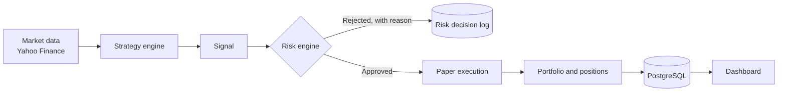

# AI Equity Trader

A **paper-trading-only** platform for testing automated trading rules on Indian equities, where every trade has to pass a risk engine before it can execute.

**Status:** working backend, API and dashboard · **no real money, no broker connection, no live orders** · 184 automated backend tests · no claim of profitability

## Overview

The project asks a practical question: what does it take to run a trading rule safely and honestly? It pulls real market data, runs simple, transparent strategies, checks every signal against explicit risk limits, and "executes" only into a simulated portfolio. It also backtests the same rules on history so they can be compared.

It is built around one design rule: **no component may bypass the risk engine.** The engine only returns *approved* or *rejected*, always with a reason, and any internal error counts as a rejection.

## Problem and intended users

- **Problem:** testing a trading idea without risking money, and seeing exactly why each trade was allowed or blocked.
- **Intended user:** someone learning or evaluating rule-based trading who wants a controlled, auditable sandbox. It is a learning and research tool, not a product for investors.

## What is implemented

| Area | What exists |
|---|---|
| Market data | Daily and 5-minute candles from Yahoo Finance through `yfinance` (no API key), with caching and staleness checks. Defaults to five NSE stocks: RELIANCE, TCS, INFY, HDFCBANK, ICICIBANK |
| Strategies | SMA crossover, RSI, and an intraday strategy combining VWAP, EMA trend, RSI momentum and volume confirmation |
| Risk engine | Approves or rejects each signal with a reason. Limits: position size, simultaneous positions, trades per day, daily loss, stale or invalid data, and an emergency stop. Protective exits such as stop-loss and target are not blocked by limits that only restrict new risk |
| Paper execution | Simulated fills with a configurable transaction cost, positions, a portfolio, and stop-loss, target and optional trailing-stop exits |
| Autonomous mode | A scheduler for trading cycles and position monitoring. It is **stopped by default** and needs an explicit start call. Handles Indian market hours and holidays, and recovers state after a restart |
| Backtesting | Daily and intraday backtests, side-by-side comparison of strategy settings, and a multi-stock comparison. Each run is isolated from the others |
| Dashboard | Next.js pages for trading status, signals, risk decisions, positions and trades, backtesting, and the intraday scanner |
| API | FastAPI under `/api/v1` with generated docs at `/docs` |

## How it works



An approved trade must have a stored *approved* risk decision, and no step substitutes synthetic data for real market data.

## Tech stack

Python 3.12, FastAPI, SQLAlchemy and Alembic, PostgreSQL 16, pandas, `yfinance`, pytest · Next.js, TypeScript, Tailwind CSS · Docker Compose.

## Run it locally

Requires Docker with Docker Compose, **or** Python 3.12+, Node.js 20+ and a local PostgreSQL 16.

```bash
cp .env.example .env
docker compose up --build
```

- Backend: http://localhost:8000 (API docs at `/docs`)
- Frontend: http://localhost:3000
- PostgreSQL: `localhost:5432`

Without Docker:

```bash
# Backend (needs PostgreSQL matching .env)
cd backend
python -m venv .venv
.venv\Scripts\activate          # macOS/Linux: source .venv/bin/activate
pip install -r requirements.txt
uvicorn app.main:app --reload

# Frontend, in a second terminal
cd frontend
npm install
npm run dev
```

On Windows, `scripts/setup-postgres.ps1` creates the local database and `trader` role. It restarts the PostgreSQL service and temporarily relaxes local authentication, so read it first and run it as Administrator only if you are comfortable with that.

### Configuration

All settings are in `.env.example` and contain **no secrets or real credentials**. The database user and password (`trader` / `trader`) are local development defaults only. The ones that matter most:

| Variable | Meaning |
|---|---|
| `TRADING_MODE=paper` | The only mode that exists. Live trading is not implemented |
| `EMERGENCY_STOP` | Blocks all new buy entries when `true` |
| `AUTONOMOUS_TRADING_ENABLED`, `INTRADAY_AUTONOMOUS_TRADING_ENABLED` | Both `false` by default. Autonomous trading needs a deliberate start request |
| `RISK_*`, `INTRADAY_RISK_*` | Position size, daily loss, trades per day and similar limits |
| `MARKET_DATA_SYMBOLS`, `MARKET_HOLIDAYS` | Which stocks to trade and which days the market is closed |

## Try it

```bash
curl http://localhost:8000/api/v1/health
curl http://localhost:8000/api/v1/system/status
```

## Tests

```bash
cd backend
pytest
```

184 tests pass in about 25 seconds. They use an in-memory SQLite database, so they need no PostgreSQL. They cover the risk engine, strategies, paper execution, backtesting, scheduler guards and restart recovery. The frontend has no automated tests, and there is no CI workflow yet.

## Limitations and next steps

- **Paper trading only, by design.** Nothing here shows that any strategy is profitable, and none should be presented as such. Backtests use historical data and simple cost assumptions.
- Yahoo Finance is an unofficial data source. It can be delayed or change without notice, and its intraday data covers only about the last 60 days.
- Fills are simulated and do not model real order-book depth or slippage beyond a flat percentage.
- The strategies are deliberately simple. There is no machine-learning model in this repository.
- The dashboard has not been tested in CI, and it needs a running backend and database.
- Next: add CI, add dashboard screenshots, and write up what the backtests did and did not show.
